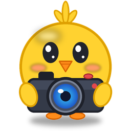

<h1 align="center">CLICK!</h1>

<b>Instant replay for Windows.</b> Press one key and the last minute of your game is saved as a clip.

<a href="https://github.com/mahyerr/CLICK/releases/latest"><b>Download the latest version</b></a>

---

CLICK! keeps the last 60 seconds of your screen and sound in the background. Press **Alt+F1** and they're saved
as a video, sorted into a folder per game. No account, nothing uploaded, and it barely uses your PC
(well under 1% CPU on most graphics cards).

## What it does

- **Saves the last minute** with Alt+F1, in a game or anywhere. Press again a bit later and you get just the new
  part, never the same footage twice.
- **Pops up over your game** when a clip is saved. The pop-up is never recorded into your clips.
- **Sorts clips by game**: Videos\CLICK!\Valorant, Videos\CLICK!\Fortnite, ...
- **Trim & share**: cut a clip down to the moment and export it for Discord (under 10 MB) or WhatsApp and phones.
- **Any graphics card**: uses the card's own video encoder (NVIDIA, AMD or Intel), so your game keeps its frames.
- **Stretched resolutions** are saved stretched, like you see them, without black bars.
- **Game sound and your mic** in one track that plays everywhere, phones included.
- **Updates itself**: when a new version is out, the app shows "Update now".

## Install

1. Download **CLICK-x.y.z-Setup.exe** from the [latest release](https://github.com/mahyerr/CLICK/releases/latest)
   and run it. No admin rights needed.
2. Windows may say "Windows protected your PC" because the app isn't signed by a big company: click
   **More info**, then **Run anyway**.
3. A short setup walks you through your save key, your microphone and where clips go.

Prefer no installer? Download **CLICK-x.y.z-Windows.zip**, unzip it anywhere and run **CLICK!.exe**.

Needs Windows 10 (2004 or newer) or Windows 11, 64-bit, and a graphics card from the last ~8 years.

## Good to know

- NVIDIA's overlay also uses Alt+F1 (for screenshots). Change CLICK!'s key on the Recording page, or turn the
  NVIDIA overlay off, and turn NVIDIA's own Instant Replay off so two recorders don't run.
- Games in exclusive fullscreen hide the pop-up (clips still save); borderless and most fullscreen
  games show it.
- Something not working? In the app, Settings > **Create diagnostics file** makes a zip with the log and a summary
  of your PC (no clips or personal files) to send along.

---

Made by Maher (Discord @hijazy). CLICK! uses [FFmpeg](https://ffmpeg.org) (GPL) for recording; see
THIRD-PARTY-NOTICES.txt in the download.
